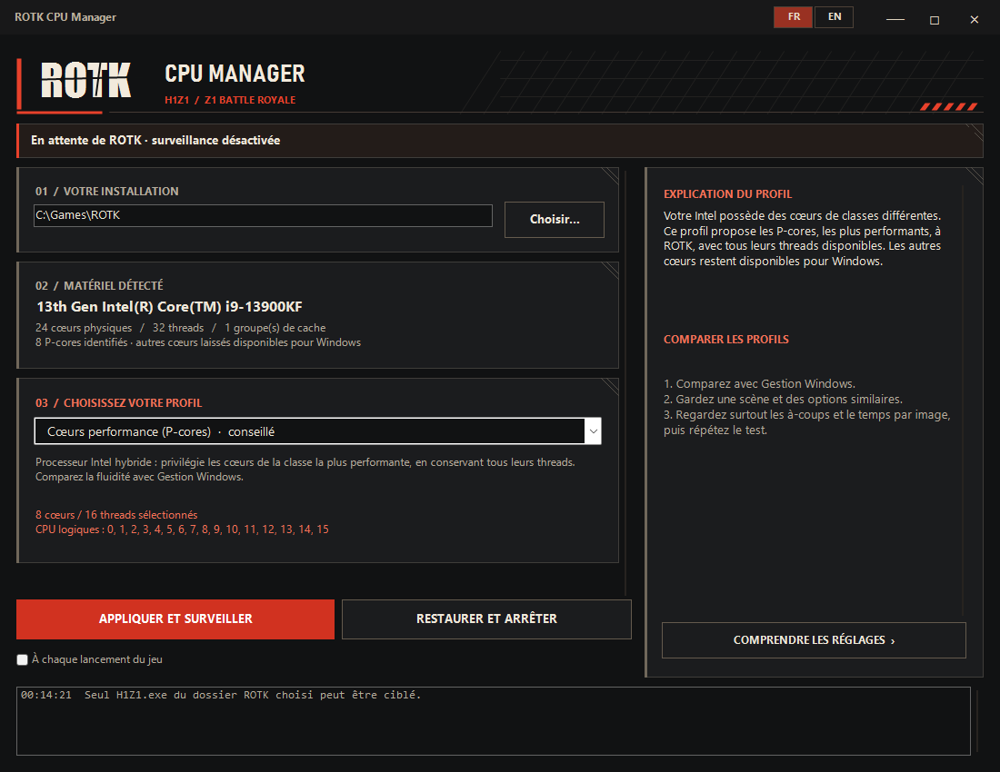

# ROTK CPU Manager

Français · [English](README.md)

Un utilitaire Windows portable qui détecte le client ROTK / Z1BR et gère ses
CPU Sets Windows. Il propose des profils à partir de la topologie réelle du
processeur et restaure les réglages précédents à l'arrêt de la surveillance.



## Télécharger

[Dernière version](https://github.com/AngATV/ROTK-CPU-Manager/releases/latest)
— Windows x64, version 1.4.0.

- [Exécutable bilingue](https://github.com/AngATV/ROTK-CPU-Manager/releases/latest/download/ROTK-CPU-Manager.exe)
- [Archive portable française](https://github.com/AngATV/ROTK-CPU-Manager/releases/latest/download/ROTK-CPU-Manager-FR-portable.zip)
- [Archive portable anglaise](https://github.com/AngATV/ROTK-CPU-Manager/releases/latest/download/ROTK-CPU-Manager-EN-portable.zip)

Chaque ZIP contient un exécutable, la notice, la licence et son empreinte.
La release inclut aussi `SHA256SUMS.txt` pour tous les exécutables et archives.

## Fonctionnalités

- Détection de `H1Z1.exe` uniquement dans l'installation ROTK sélectionnée.
- Profils adaptés aux Intel hybrides et aux groupes de cache L3 AMD.
- Variante expérimentale avec un thread logique par cœur physique.
- Application du profil après chaque relancement du jeu.
- Interface et explications en français et en anglais.
- Un seul exécutable, sans installation, accès réseau ni télémétrie.

## Prérequis

Windows 10 ou 11 **x64**, avec **.NET Framework 4.8**, déjà présent sur les
installations Windows récentes. Aucun SDK ni runtime .NET moderne n'est requis.

## Processeurs pour lesquels l'app est pertinente

Exemples de CPU de bureau, liste non exhaustive. L'app utilise la topologie
détectée par Windows : le nom du modèle ne sert pas de liste blanche. Les profils
ci-dessous sont des pistes à comparer en jeu, pas des gains certifiés.

| Famille | Exemples | Profils proposés et intérêt |
| --- | --- | --- |
| Intel Core 12e génération hybrides | i5-12600K/KF, i7-12700K/KF, i9-12900K/KF | P-cores conseillés ; essai sans Hyper-Threading si disponible |
| Intel Core 13e génération hybrides | i5-13600K/KF, i7-13700K/KF, i9-13900K/KF | Même sélection des P-cores |
| Intel Core 14e génération hybrides | i5-14600K/KF, i7-14700K/KF, i9-14900K/KF | Même sélection des P-cores |
| Intel Core Ultra 200S et 200S Plus | Ultra 5 245K/KF, 250K/KF Plus ; Ultra 7 265K/KF, 270K Plus ; Ultra 9 285K | P-cores conseillés ; aucune variante sans HT si le CPU n'en expose pas |
| AMD Ryzen 9 X3D avec caches asymétriques | 7900X3D, 7950X3D, 9900X3D, 9950X3D | Groupe au grand cache conseillé si les tailles L3 sont confirmées ; essais sans SMT |
| AMD Ryzen 9 avec plusieurs groupes L3 comparables | 5900X, 5950X, 7900X, 7950X, 9900X, 9950X ; 9950X3D2 Dual Edition | Gestion Windows conseillée ; groupes L3 et variantes sans SMT à essayer |
| AMD Ryzen X3D à un seul groupe L3 | 5800X3D, 7800X3D, 9800X3D, 9850X3D | Gestion Windows conseillée ; essai avec un thread par cœur, sans sélection de CCD |
| AMD Ryzen 5 3600 / 3600X | 6 cœurs, 12 threads avec SMT | Gestion Windows conseillée ; essai à 6 threads. Les groupes de trois cœurs sont exclus |
| Intel homogènes avec Hyper-Threading | Au moins quatre cœurs physiques, sans classes P/E distinctes | Gestion Windows conseillée ; essai avec un thread par cœur |
| Intel homogènes sans Hyper-Threading | Sans classes P/E distinctes | Gestion Windows uniquement : pas de restriction pertinente à proposer |

Les Intel de 12e génération ne sont pas tous hybrides : les i5-12400 et i5-12600
sans suffixe K, par exemple, ne disposent pas d'E-cores. Le 9950X3D2 possède du
3D V-Cache sur ses deux chiplets : il n'est pas traité comme un X3D à caches asymétriques.
Sur portable, la même logique s'applique si Windows identifie au moins quatre
cœurs de la classe la plus performante. Un modèle absent de la liste peut fonctionner.

La détection matérielle et les API Windows ont été vérifiées sur un **i9-13900KF**.
Les autres topologies sont couvertes par simulation. Aucun gain de performance
dans ROTK n'a été mesuré par benchmark.

Références constructeur : [Intel 12e génération](https://cdrdv2-public.intel.com/710604/12th-gen-processor-product-brief.pdf),
[13e génération](https://download.intel.com/newsroom/2022/2022innovation/13th-Gen-Intel-Core-Desktop-Media-presentation.pdf),
[14e génération](https://www.intel.com/content/www/us/en/newsroom/news/intel-core-14th-gen-desktop-processors.html),
[Core Ultra 200S](https://www.intel.com/content/www/us/en/support/articles/000099656/processors.html),
[Ryzen](https://www.amd.com/en/products/processors/desktops/ryzen.html),
[Ryzen 3600](https://www.amd.com/en/newsroom/press-releases/2019-5-26-amd-announces-next-generation-leadership-products.html)
et [9950X3D2](https://newsroom.amd.com/news/amd-launches-ryzen-9-9950x3d2-dual-edition-processor/).

## Utilisation

1. Extrayez l'archive portable et lancez `ROTK-CPU-Manager.exe`.
2. Sélectionnez le dossier ROTK s'il diffère de `C:\Games\ROTK`.
   Il doit contenir `H1Z1.exe` et `rotkc.dll`.
3. Choisissez un profil puis **Appliquer et surveiller**.
4. **Restaurer et arrêter** remet les CPU Sets présents avant la première modification.

Le jeu peut être lancé avant ou après l'outil. Minimiser garde la surveillance
active dans la zone de notification ; fermer restaure les réglages du jeu encore
ouvert. L'outil doit rester ouvert pour détecter les lancements. La surveillance
est désactivée lors de la première utilisation.

Les exécutables FR et EN démarrent dans leur langue respective. Toutes les
variantes permettent de changer de langue et partagent les préférences dans
`%LOCALAPPDATA%\ROTK CPU\settings.xml`. Une seule instance peut être ouverte.

## Choix des profils

| Topologie détectée | Point de départ conseillé |
| --- | --- |
| Intel hybride, au moins quatre cœurs de la classe la plus performante | Cœurs performance, avec les threads Hyper-Threading disponibles |
| AMD avec plusieurs groupes L3 et un cache dépassant deux fois le plus petit | Groupe au plus grand cache, SMT conservé |
| Caches identiques, groupe unique, topologie inconnue ou insuffisante | Gestion Windows |
| Plusieurs groupes de processeurs Windows | Gestion Windows uniquement |

Les profils sans SMT choisissent un thread logique par cœur physique, sans
désactiver le SMT du PC. Les profils de cache nécessitent au moins quatre cœurs
physiques dans le groupe. Une taille de cache inconnue empêche la recommandation
AMD « grand cache ».

## Périmètre et limites

La recommandation ne repose pas sur un benchmark ROTK. Comparez des scènes
similaires et les temps par image avant de conserver une restriction.

Seul le chemin exact du jeu est ciblé. Le marqueur d'installation est un contrôle
de chemin, pas une authentification cryptographique. Aucun fichier du jeu,
pilote, service, priorité, affinité stricte ou réglage global Windows n'est modifié.

Les CPU Sets sont des préférences de répartition proposées à Windows. Une
affinité existante ou un réglage propre à un thread peut prendre le dessus.
L'accès au processus peut être refusé ; l'outil signale l'erreur et ne contourne
aucune protection.

Si la restauration échoue, la session est conservée pour réessayer et la
fermeture est annulée. En cas de plantage ou d'arrêt forcé, relancez le jeu pour
réinitialiser ses CPU Sets. La version actuelle n'est pas signée ; Windows peut
afficher une alerte SmartScreen.

## Compilation et vérification

À la racine du dépôt, depuis Windows PowerShell 5.1 :

```powershell
powershell -NoProfile -ExecutionPolicy Bypass -File .\build.ps1 -Test -Render
```

Le script utilise le compilateur C# de .NET Framework fourni par Windows, sans
NuGet ni téléchargement. Les avertissements de compilation sont traités comme
des erreurs. Les fichiers sont produits dans `dist/`. Ajoutez
`-OutputDirectory dist\review` si une ancienne version est encore ouverte.

La sortie comprend les exécutables bilingue, FR et EN, les archives portables,
leurs empreintes SHA-256 et les aperçus. Les tests couvrent les profils, les
structures CPU, les chemins, les préférences, les langues, les contrôles de
fenêtre et les cycles d'application/restauration sur des processus de test
temporaires. Ils ne modifient jamais un processus ROTK installé.

GitHub Actions compile et vérifie le projet sous Windows lors des envois et des
pull requests. Le code utilise C# 5 et WinForms ; le formatage est défini dans
`.editorconfig`. L'organisation des sources est détaillée dans le [README anglais](README.md#source-layout).

## Licence

[MIT](LICENSE). Projet indépendant ; voir [NOTICE.txt](NOTICE.txt).
