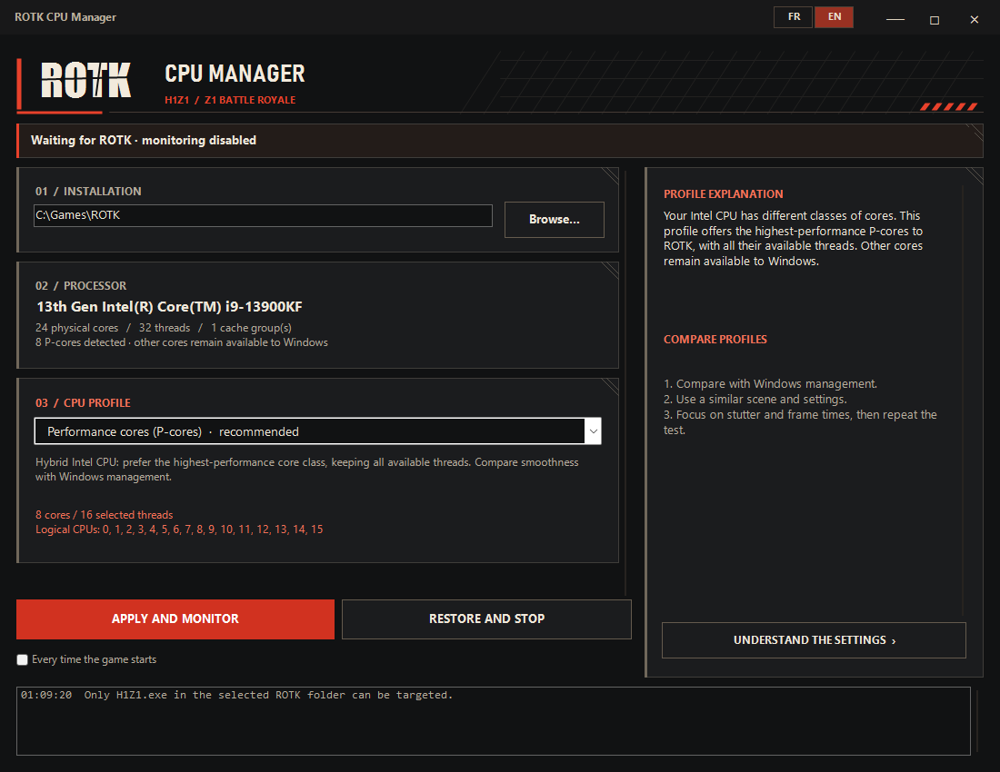

# ROTK CPU Manager

[Français](README.fr.md) · English

A portable Windows utility that detects the ROTK / Z1BR client and manages its
Windows CPU Sets. It suggests profiles from the processor's actual topology and
restores the game's previous settings when monitoring stops.



## Download

[Latest release](https://github.com/AngATV/ROTK-CPU-Manager/releases/latest)
— Windows x64, version 1.4.1.

Version 1.4.1 fixes scrolling in "Understand the settings", including small
movements from precision mouse wheels.

- [Bilingual executable](https://github.com/AngATV/ROTK-CPU-Manager/releases/latest/download/ROTK-CPU-Manager.exe)
- [French portable ZIP](https://github.com/AngATV/ROTK-CPU-Manager/releases/latest/download/ROTK-CPU-Manager-FR-portable.zip)
- [English portable ZIP](https://github.com/AngATV/ROTK-CPU-Manager/releases/latest/download/ROTK-CPU-Manager-EN-portable.zip)

Each ZIP contains one executable, instructions, a license and its checksum.
The release also includes `SHA256SUMS.txt` for all executables and archives.

## Features

- Detects `H1Z1.exe` only in the selected ROTK installation.
- Suggests profiles for hybrid Intel processors and AMD L3 cache groups.
- Offers one logical thread per physical core as an experimental profile.
- Reapplies the selected profile when the game restarts.
- Includes French and English interfaces and explanations of each profile.
- Runs from one executable, without installation, network access or telemetry.

## Requirements

Windows 10 or 11 **x64**, with **.NET Framework 4.8**, included in recent Windows
installations. No modern .NET runtime or SDK is required to run the app.

## CPUs this app is useful for

Desktop examples, not an exhaustive list. The app uses Windows-reported topology,
not a model-name allowlist. These profiles are starting points to compare in the
game, not certified performance gains.

| Family | Examples | Available profiles and purpose |
| --- | --- | --- |
| Hybrid Intel Core 12th Gen | i5-12600K/KF, i7-12700K/KF, i9-12900K/KF | P-cores recommended; without-HT trial when available |
| Hybrid Intel Core 13th Gen | i5-13600K/KF, i7-13700K/KF, i9-13900K/KF | Same P-core selection |
| Hybrid Intel Core 14th Gen | i5-14600K/KF, i7-14700K/KF, i9-14900K/KF | Same P-core selection |
| Intel Core Ultra 200S and 200S Plus | Ultra 5 245K/KF, 250K/KF Plus; Ultra 7 265K/KF, 270K Plus; Ultra 9 285K | P-cores recommended; no without-HT trial if the CPU exposes no HT |
| AMD Ryzen 9 X3D with asymmetric caches | 7900X3D, 7950X3D, 9900X3D, 9950X3D | Large-cache group recommended when L3 sizes are confirmed; without-SMT trials |
| AMD Ryzen 9 with comparable L3 groups | 5900X, 5950X, 7900X, 7950X, 9900X, 9950X; 9950X3D2 Dual Edition | Windows recommended; L3-group and without-SMT trials |
| AMD Ryzen X3D with one L3 group | 5800X3D, 7800X3D, 9800X3D, 9850X3D | Windows recommended; one-thread-per-core trial, no CCD selection |
| AMD Ryzen 5 3600 / 3600X | 6 cores, 12 threads with SMT | Windows recommended; 6-thread trial. Three-core cache groups are excluded |
| Homogeneous Intel with Hyper-Threading | At least four physical cores, without distinct P/E classes | Windows recommended; one-thread-per-core trial |
| Homogeneous Intel without Hyper-Threading | Without distinct P/E classes | Windows only: no useful restriction to offer |

Not every 12th Gen Intel is hybrid: the i5-12400 and non-K i5-12600, for example,
have no E-cores. The 9950X3D2 has 3D V-Cache on both chiplets; it is not treated
as an asymmetric-cache X3D. On laptops, the same logic applies when Windows
identifies at least four cores in the highest-performance class. Unlisted models
can also work.

Topology detection and Windows API checks were performed on an **i9-13900KF**.
Other CPU layouts are covered by simulation. Performance gains in ROTK have not
been benchmarked.

Manufacturer references: [Intel 12th Gen](https://cdrdv2-public.intel.com/710604/12th-gen-processor-product-brief.pdf),
[13th Gen](https://download.intel.com/newsroom/2022/2022innovation/13th-Gen-Intel-Core-Desktop-Media-presentation.pdf),
[14th Gen](https://www.intel.com/content/www/us/en/newsroom/news/intel-core-14th-gen-desktop-processors.html),
[Core Ultra 200S](https://www.intel.com/content/www/us/en/support/articles/000099656/processors.html),
[Ryzen](https://www.amd.com/en/products/processors/desktops/ryzen.html),
[Ryzen 3600](https://www.amd.com/en/newsroom/press-releases/2019-5-26-amd-announces-next-generation-leadership-products.html)
and [9950X3D2](https://newsroom.amd.com/news/amd-launches-ryzen-9-9950x3d2-dual-edition-processor/).

## Usage

1. Extract the portable archive and run `ROTK-CPU-Manager.exe`.
2. Select the ROTK folder if it differs from `C:\Games\ROTK`.
   It must contain `H1Z1.exe` and `rotkc.dll`.
3. Choose a profile, then select **Apply and monitor**.
4. Use **Restore and stop** to restore the CPU Sets present before the first change.

The game can be started before or after the tool. Minimizing keeps monitoring
active in the notification area; closing restores a running game's settings.
The app must remain open to detect launches. Monitoring is disabled on first use.

FR and EN executables start in their respective language. All variants allow
switching languages and share preferences in `%LOCALAPPDATA%\ROTK CPU\settings.xml`.
Only one instance can run at a time.

## Profile selection

| Detected topology | Recommended starting point |
| --- | --- |
| Hybrid Intel, at least four cores in the highest efficiency class | Performance cores, with available Hyper-Threading threads |
| AMD with several L3 groups and one cache more than twice as large as the smallest | Largest-cache group, with SMT |
| Equal cache groups, one cache group, unknown or insufficient topology | Windows management |
| Several Windows processor groups | Windows management only |

Without-SMT profiles select one logical thread per physical core; they do not
disable SMT system-wide. Cache-group profiles need at least four physical cores
in the group. Unknown cache sizes never trigger the AMD large-cache recommendation.

## Scope and limitations

Profiles are a starting point, not a measured performance guarantee. Compare
similar scenes and frame times in ROTK before keeping a restriction.

Only the matching executable path is changed. The installation marker is a path
check, not cryptographic verification. The app modifies no game files, drivers,
services, process priorities, hard affinity or global Windows settings.

Windows CPU Sets are scheduling preferences. Existing affinity or per-thread
CPU Sets can take precedence. Access restrictions may prevent applying a profile;
the tool reports the error and does not bypass process protection.

If restoration fails, the session remains available for retry and closing is
cancelled. If the app crashes or is forcibly terminated, restart the game to reset
its CPU Sets. The current build is unsigned; Windows may show a SmartScreen warning.

## Build and test

From the repository root, using Windows PowerShell 5.1:

```powershell
powershell -NoProfile -ExecutionPolicy Bypass -File .\build.ps1 -Test -Render
```

The script uses the Windows .NET Framework C# compiler, without NuGet or downloads.
Compiler warnings are treated as errors. Output goes to `dist/`; add
`-OutputDirectory dist\review` if an older executable is still running.

Output includes bilingual, FR and EN executables, portable ZIP archives, SHA-256
checksums and previews. Tests cover profiles, topology parsing, path matching,
preferences, translations, window controls and apply/restore cycles against
temporary test processes. They never modify an installed ROTK process.

GitHub Actions runs the build and tests on Windows for pushes and pull requests.

## Source layout

| Files | Purpose |
| --- | --- |
| `CpuTopology.cs`, `Profiles.cs` | CPU topology and profile selection |
| `Native.cs`, `GameGuard.cs`, `GameWatcher.cs` | Windows APIs, process validation and restoration |
| `MainForm.cs`, `GuideForm.cs`, `Tactical*.cs`, `WindowChrome.cs` | Interface and explanations |
| `Locale.cs`, `Settings.cs`, `Program.cs` | Translation, preferences and startup |
| `tests/Tests.cs` | Self-contained checks and preview rendering |

The implementation targets C# 5 and WinForms. Formatting is defined in
`.editorconfig`. See [CONTRIBUTING.md](CONTRIBUTING.md) for changes and bug reports.

## License

[MIT](LICENSE). Independent project; see [NOTICE.txt](NOTICE.txt).
